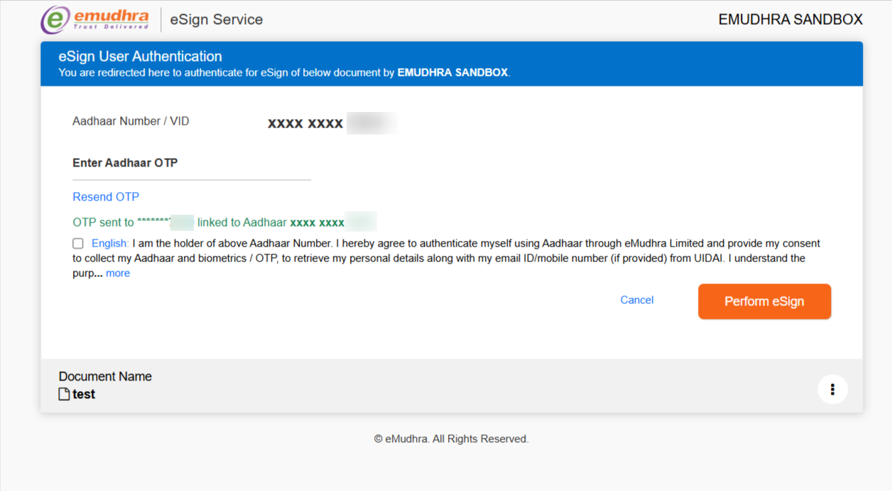
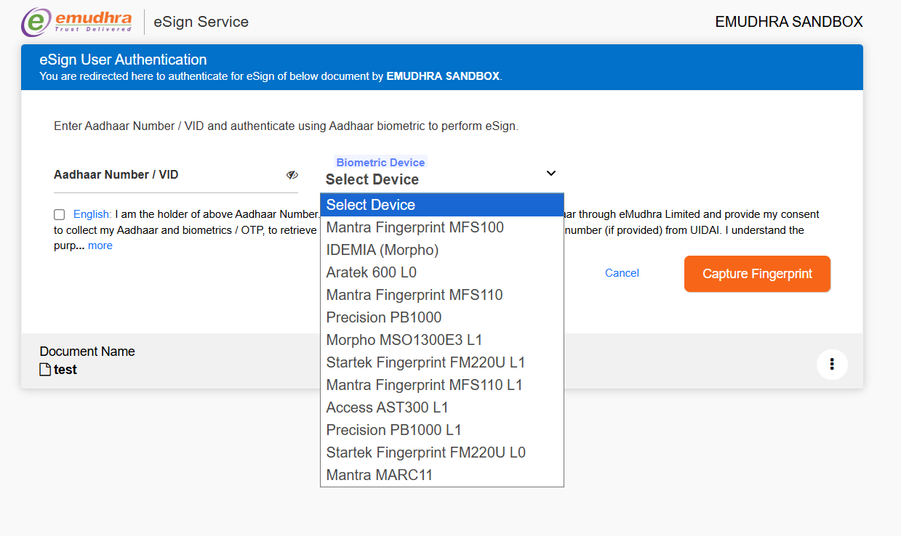
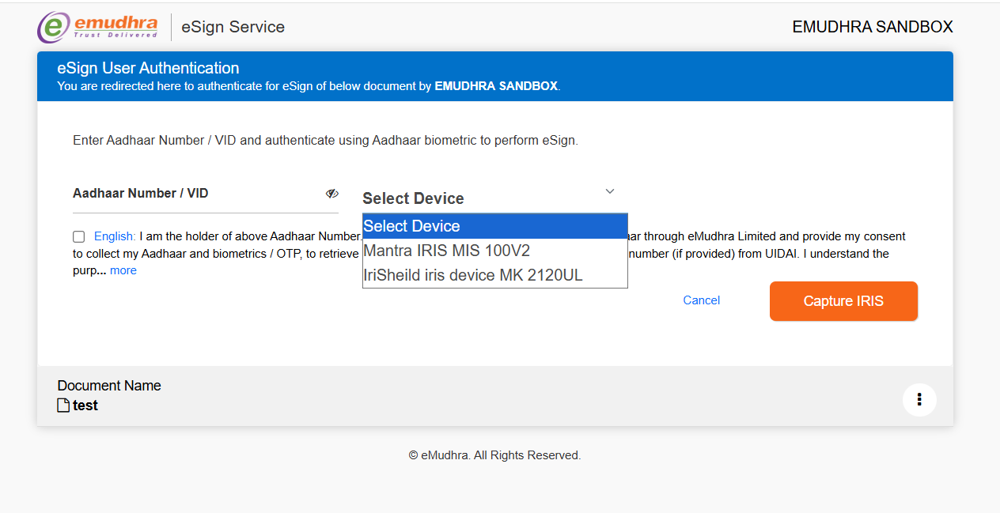
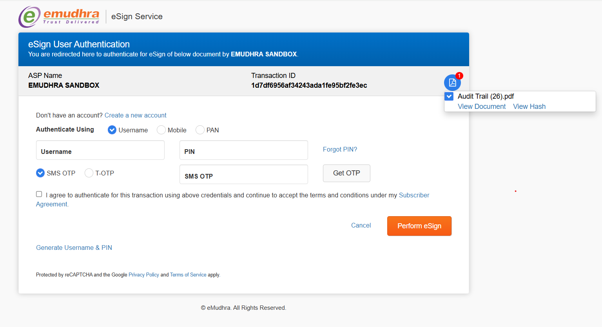

# eSign Java SDK - Integration Guide

A Java SDK for PDF digital signing. Supports signing via **eMudhra's eSign gateway** (Aadhaar/PAN-based authentication) and **any external signing authority** (HSM, TSP, or corporate CA) through a vendor-agnostic API.

## Table of Contents

- [Overview](#overview)
- [Prerequisites](#prerequisites)
- [Quick Start](#quick-start)
- [Signing Flows](#signing-flows)
  - [Aadhaar Signing (V2 API)](#aadhaar-signing-v2-api)
  - [Encrypted Aadhaar Flow](#encrypted-aadhaar-flow)
  - [PAN Signing (V3 API)](#pan-signing-v3-api)
  - [Encrypted Aadhaar Flow](#encrypted-aadhaar-flow)
  - [Vendor-Agnostic Signing](#vendor-agnostic-signing)
- [Customising the Aadhaar Page (custUI)](#customising-the-aadhaar-page-custui)
- [Signature Appearance Types](#signature-appearance-types)
- [Page Selection and Coordinates](#page-selection-and-coordinates)
- [Multi-Document Signing](#multi-document-signing)
- [Hash-Based Signing](#hash-based-signing)
- [Aadhaar Appearance Patching](#aadhaar-appearance-patching)
- [Customising the Aadhaar Appearance](#customising-the-aadhaar-appearance)
- [Signer Certificate Details](#signer-certificate-details)
- [Verifying a Signature](#verifying-a-signature)
- [Signature Content Position](#signature-content-position)
- [API Reference](#api-reference)
  - [Constructors](#constructors)
  - [Methods](#methods)
  - [eSignInputBuilder](#esigninputbuilder)
  - [EncryptedAadhaarConfig](#encryptedaadhaarconfig)
  - [eSignServiceReturn](#esignservicereturn)
  - [ReturnDocument](#returndocument)
  - [Enums](#enums)
- [Error Codes](#error-codes)
- [Logging](#logging)
- [Building from Source](#building-from-source)

---

## Overview

### eMudhra Gateway Flow (Aadhaar / PAN)

```
Phase 1: getGatewayParameter()
  Your App --> SDK (pre-sign PDF, compute hash) --> eSign Gateway --> Returns redirect URL

Phase 2: User Authentication + getSigedDocument()
  User --> eMudhra Portal (OTP/Fingerprint/IRIS/Face) --> Your Callback URL --> SDK (inject signature + patch appearance)
```

1. **Phase 1** - Your application sends the PDF to the SDK. The SDK creates a signature placeholder, computes a SHA-256 hash, builds an XML request, signs it with your PFX certificate, and POSTs to the eSign gateway. You get back a gateway parameter to redirect the user.

> **Exception:** in the [Encrypted Aadhaar Flow](#encrypted-aadhaar-flow) Phase 1 makes **no** call to the eSign gateway - the SDK pre-signs the PDF, signs the request XML and returns a wrapper that your application posts to the gateway itself.

2. **Phase 2** - The user authenticates on eMudhra's portal. eMudhra sends the PKCS7 signature back to your callback URL. You pass it to the SDK, which injects the signature into the pre-signed PDF and returns the signed document as Base64.

> **Note:** After injecting the PKCS7 signature, the SDK automatically patches the visual appearance of every signature field with the signer's name and masked Aadhaar number (e.g. `**** **** 1234`) extracted from the gateway-returned certificate.

### Vendor-Agnostic Flow (any PKI / HSM / TSP)

```
prepareDocuments()  -->  SHA-256 hash per document
Your signing service (HSM / TSP / corporate CA)  -->  PKCS7 per document
appendSignatures()  -->  signed PDF per document
```

Use `prepareDocuments()` and `appendSignatures()` to decouple PDF processing from the signing authority. The SDK handles placeholder creation and PKCS7 injection; you supply the signatures from any source. See [Vendor-Agnostic Signing](#vendor-agnostic-signing).

---

## Prerequisites

- **Java 11** or higher
- **eSignASPLibrary5_13.jar** (the SDK JAR from `dist/`)
- **All dependency JARs** from the `lib/` folder:
  - batik-all-1.17.jar
  - commons-io-2.14.0.jar
  - log4j-api-2.25.3.jar
  - xmlsec-2.3.4.jar
  - woodstox-core-6.4.0.jar
  - stax2-api-4.2.1.jar
  - slf4j-api-1.7.32.jar
  - slf4j-simple-1.7.32.jar
  - org.w3c.dom.svg-1.1.0.jar
  - xmlgraphics-commons-2.9.jar
- **PFX certificate file** (.pfx) provided by eMudhra for XML signing
- **ASP ID** (Application Service Provider ID) from eMudhra
- **eSign URLs** (v1 and v2 gateway endpoints) from eMudhra

---

## Quick Start

Minimal end-to-end Aadhaar signing example:

```java
import com.emudhra.esign.*;
import java.io.File;
import java.nio.file.Files;
import java.util.ArrayList;

// 1. Initialize the SDK
eSign esignObj = new eSign(
    "YOUR_ASP_ID",
    "https://esigngateway.emudhra.com/eSignRequest",   // eSign URL v1
    "https://esigngateway.emudhra.com/v2/eSignRequest", // eSign URL v2
    "/path/to/certificate.pfx",
    "pfxPassword",
    "pfxAlias",
    21000  // SignatureContents size
);

// 2. Prepare the PDF as Base64
byte[] pdfBytes = Files.readAllBytes(new File("/path/to/document.pdf").toPath());
String pdfBase64 = java.util.Base64.getEncoder().encodeToString(pdfBytes);

// 3. Build the signing input
eSignInput input = eSignInputBuilder.init()
    .setDocBase64(pdfBase64)
    .setDocInfo("Contract Agreement")
    .setDocURL("https://yourapp.com/docs/contract.pdf")
    .setSignedBy("John Doe")
    .setLocation("Bangalore")
    .setReason("Agreement Signing")
    .setAppearanceType(eSign.AppearanceType.StandardSignature)
    .setPageTobeSigned(eSign.PageTobeSigned.Last)
    .setCoordinates(eSign.Coordinates.BottomRight)
    .setCoSign(true)
    .setBorderRequired(true)
    .build();

ArrayList<eSignInput> inputs = new ArrayList<>();
inputs.add(input);

// 4. Phase 1: Get the gateway parameter (Aadhaar uses V2)
eSignServiceReturn result = esignObj.getGatewayParameter(
    inputs,
    "",                                  // signerID (not used for Aadhaar/V2; for PAN/V3 it autofills username on authenticator page)
    "TXN-" + System.currentTimeMillis(), // transaction ID (< 50 chars)
    "https://yourapp.com/esign/callback", // response URL (eMudhra POSTs back here)
    "https://yourapp.com/esign/redirect", // redirect URL
    "/tmp/esign",                   // temp folder for pre-signed files
    eSign.eSignAPIVersion.V2,       // V2 for Aadhaar signing
    eSign.AuthMode.OTP              // authentication mode
);

if (result.getStatus() == 1) {
    String gatewayParam = result.getGatewayParameter();
    String tempFilePath = result.getPreSignedTempFile();
    // Store tempFilePath in session - you'll need it in Phase 2

    // 5. Redirect user to eMudhra's authentication page
    // Form POST: txnref=gatewayParam to https://authenticate.sandbox.emudhra.com/AadhaareSign.jsp
}

// 6. Phase 2: In your callback handler, after eMudhra POSTs back
//    eMudhra sends: txnref (transaction ref) and XML (response XML)
String eSignResponseXML = request.getParameter("XML");

eSignServiceReturn signResult = esignObj.getSigedDocument(
    eSignResponseXML,
    tempFilePath  // the pre-signed temp file path from Phase 1
);

if (signResult.getStatus() == 1) {
    for (ReturnDocument doc : signResult.getReturnDocuments()) {
        String signedPdfBase64 = doc.getSignedDocument();
        // Decode and save: byte[] signedPdf = Base64.decode(signedPdfBase64);
    }
}
```

---

## Signing Flows

### Aadhaar Signing (V2 API)

Uses Aadhaar-based authentication. The user is redirected to eMudhra's eSign gateway where they enter their Aadhaar number and authenticate using OTP, Fingerprint, or IRIS. After the user clicks **"Perform eSign"**, eMudhra POSTs the signed response back to your `responseUrl` and the user is redirected to your `redirectUrl`.

#### Gateway Authentication Screens

**OTP Authentication** — The user enters their Aadhaar number, receives an OTP on their linked mobile, and clicks "Perform eSign":



**Fingerprint Authentication** — The user enters their Aadhaar number and selects a biometric device to capture their fingerprint:



**IRIS Authentication** — The user enters their Aadhaar number and selects an IRIS scanner device:



**Step 1: Initialize**

```java
eSign esignObj = new eSign(
    "YOUR_ASP_ID",
    "https://esigngateway.emudhra.com/eSignRequest",
    "https://esigngateway.emudhra.com/v2/eSignRequest",
    "/path/to/certificate.pfx", "pfxPassword", "pfxAlias", 21000
);
```

**Step 2: Build input and get gateway parameter**

```java
// Build eSignInput (see Signature Appearance Types section for details)
ArrayList<eSignInput> inputs = new ArrayList<>();
inputs.add(input);

eSignServiceReturn result = esignObj.getGatewayParameter(
    inputs, "", transactionID,                         // signerID not used for Aadhaar/V2 (used in PAN/V3 to autofill username)
    "https://yourapp.com/esign/aadhaar-callback",      // responseUrl (eMudhra POSTs back here)
    "https://yourapp.com/esign/redirect",              // redirectUrl
    "/tmp/esign",
    eSign.eSignAPIVersion.V2,                          // V2 for Aadhaar signing
    eSign.AuthMode.OTP
);

// Store for Phase 2
String gatewayParam = result.getGatewayParameter();
String tempFile = result.getPreSignedTempFile();
```

**Step 3: Redirect user to eMudhra**

Submit an HTML form POST to eMudhra's Aadhaar eSign page:

```html
<form method="POST" action="https://authenticate.sandbox.emudhra.com/AadhaareSign.jsp">
    <input type="hidden" name="txnref" value="${gatewayParam}" />
    <input type="submit" value="Sign with Aadhaar" />
</form>
```

**Step 4: Handle callback**

eMudhra POSTs to your `responseUrl` with form parameters `txnref` and `XML`:

```java
// In your callback endpoint handler
String responseXML = request.getParameter("XML");

eSignServiceReturn signResult = esignObj.getSigedDocument(responseXML, tempFile);

if (signResult.getStatus() == 1) {
    for (ReturnDocument doc : signResult.getReturnDocuments()) {
        String signedPdfBase64 = doc.getSignedDocument();
        // Save or process the signed PDF
    }
}
```

---

### Encrypted Aadhaar Flow

> **Off by default.** This flow activates **only** when **both** `setEncryptedAadhaarFlowEnabled(true)` **and** `setEncryptedAadhaarConfig(...)` are set on an `eSignInput`. If neither is set, `getGatewayParameter()` behaves exactly as documented above, byte for byte.

The Encrypted Aadhaar flow lets an ASP pre-fill the signer's Aadhaar number at the eMudhra gateway instead of the signer typing it on the gateway page. The SDK RSA-encrypts the Aadhaar number with a certificate you supply and returns a URL-encoded XML wrapper as the `gatewayParameter`.

> **Approval required.** Sharing an Aadhaar number from an ASP to an ESP requires UIDAI approval. Do not enable this flow in production without it.

> **Designed for Aadhaar / V2.** This flow is designed for `eSign.eSignAPIVersion.V2` (Aadhaar) with a **single document** per transaction. The SDK does **not** enforce either restriction - it will build the wrapper for V3/PAN and for multi-document requests - but the gateway is not expected to accept them.

#### Certificate

Supply the RSA public-key certificate issued for this flow (UIDAI/eMudhra - **confirm which certificate applies with your eMudhra onboarding contact before production use**). The SDK is issuer-neutral: it validates only that the file parses as an X.509 certificate and that its public key is RSA. It performs **no** chain validation, **no** issuer check and **no** revocation check, and an **expired certificate is accepted with a warning written to the SDK log** rather than rejected. Supplying the wrong certificate produces a request the gateway cannot decrypt, and the failure will surface only on the gateway page - never in `getGatewayParameter()`'s return value.

The Subject DN, Issuer DN, serial number and SHA-256 fingerprint of the certificate actually used are written to the SDK log on every call, so the key in use is auditable and a substitution is detectable. Pin your monitoring on the **SHA-256 fingerprint**, not the DN - the DN is chosen by whoever issued the certificate. Note that this audit record is written at WARNING level and is therefore **suppressed entirely under `LogType.NoLog`**; integrators who disable logging accept the loss of this control.

`cerFilePath` **MUST** come from trusted server-side configuration and **MUST NOT** be derived from an HTTP request, a request parameter or any other untrusted input. Any path beginning with two separators in any combination (`\\host\share\...`, `//host/share/...`, `\/host/...`) is rejected with `ESS-131`. For request-driven scenarios use `cerBase64` instead. `cerBase64` is the Base64 encoding of the **raw certificate file bytes** - the file itself may be DER or PEM. (Passing PEM text directly, with its `-----BEGIN CERTIFICATE-----` header, is not valid Base64 and returns `ESS-132`.)

#### Step 1: Configure the input

```java
EncryptedAadhaarConfig cfg = new EncryptedAadhaarConfig();
cfg.setAadhaarNumber("123456789012");                  // exactly 12 digits, no spaces or separators
cfg.setCerFilePath("/etc/esign/aadhaar-public.cer");   // OR
// cfg.setCerBase64(base64OfTheRawCerFileBytes);

eSignInput input = eSignInputBuilder.init()
        .setDocBase64(pdfBase64)
        .setDocInfo("Agreement")
        // ... your usual appearance settings ...
        .setEncryptedAadhaarFlowEnabled(true)
        .setEncryptedAadhaarConfig(cfg)
        .build();
```

#### Step 2: Get the gateway parameter

Call `getGatewayParameter()` exactly as in the Aadhaar (V2) example above. On success `getStatus()` is `1` and `getGatewayParameter()` returns the **URL-encoded** form of:

```xml
<eSignXML>
  <EncryptedAadhaar txn="TRANSACTION_ID">Base64(RSA-encrypted Aadhaar)</EncryptedAadhaar>
  <Base64eSignXML>Base64(signed eSign request XML)</Base64eSignXML>
</eSignXML>
```

The ciphertext is Base64 of an RSA block whose length equals the certificate's modulus size (344 Base64 characters for an RSA-2048 certificate).

#### Step 3: Post the value to the gateway

The value **MUST** be sent to the gateway as an **HTTP POST form field named `XML`**, and nothing else:

```html
<form method="POST" action="https://authenticate.sandbox.emudhra.com/AadhaareSign.jsp">
    <input type="hidden" name="XML" value="${gatewayParam}" />
    <input type="submit" value="Sign with Aadhaar" />
</form>
```

The form field name is **`XML`** - not `txnref`, which is the field used by the standard Aadhaar flow above.

> **The field name is not verified by this SDK.** `XML` is taken from the reference implementation's documentation, not from an observed gateway exchange, and note that this same document records `XML` as a field eMudhra POSTs *inbound* to your `responseUrl`. Confirm the expected outbound field name with your eMudhra onboarding contact together with the encoding question below. The transport requirement (POST, never GET) is **not** conditional on that answer.

The value **MUST NOT** appear in a URL, a query string, a `GET` request, a redirect `Location` header, an anchor `href`, a browser-visible log, a server access log, or any analytics/APM capture. It carries an RSA-encrypted Aadhaar number **and** the complete XML-DSig-signed request (your ASP ID, document hashes, callback URLs and signing certificate) and is thousands of characters long. Serve the page that carries it with `Cache-Control: no-store`, and **do not log this value**.

> **Encoding hazard.** `getGatewayParameter()` returns a value that is **already percent-encoded** by the SDK. The standard flow returns a raw Base64 string that is not. If you place this value in an HTML form field, the browser will percent-encode the form body again on submit, so the gateway receives a **double-encoded** value. This is a stated fact about the value's shape, not a solved problem: the correct handling depends on how the gateway decodes the `XML` field, which is **not verified in this SDK**. Confirm the expected encoding with your eMudhra onboarding contact before going live.

#### Behavioural differences from the standard flow

| | Standard Aadhaar (V2) | Encrypted Aadhaar |
|---|---|---|
| Gateway call in Phase 1 | Yes (HTTPS POST) | **No** - skipped entirely |
| `getGatewayParameter()` | Base64 of `txn\|resCode` | URL-encoded wrapper XML |
| Form field name | `txnref` | **`XML`** |
| `getResponseCode()` | Gateway response code | **`null`** |
| Gateway-side validation of your request | Reported in Phase 1 as `ESS-103`/`ESS-104`/gateway codes | Not available - surfaces only on the gateway page |

Because Phase 1 makes no gateway call, `getStatus() == 1` **no longer means the gateway accepted the request** - it means the SDK built the wrapper successfully. The POST from eMudhra to your `responseUrl` is the only true success/failure signal; monitor that callback, not this return value.

**Phase 2 is unchanged.** Pass the response XML and `getPreSignedTempFile()` to `getSigedDocument()` exactly as in the standard Aadhaar flow.

#### Handling PII

The Aadhaar number is PII. The SDK never logs it, never places it in an error message, never writes it to the pre-signed temp file and never puts it in a URL - only the RSA ciphertext leaves the SDK. **That guarantee ends at your code.** `eSignInput` now exposes `getEncryptedAadhaarConfig()`, and `EncryptedAadhaarConfig.getAadhaarNumber()` returns the raw number, so an `eSignInput` instance transitively holds a plaintext Aadhaar. Anything in your application that reflects over it - Jackson/Gson serialization, Spring request/response logging, `toString()` dumps, session or cache persistence, APM/tracing capture, heap dumps - becomes a **new PII leak vector outside this SDK's control**. Do not serialize, log, cache or persist `eSignInput` or `EncryptedAadhaarConfig`, and discard both as soon as `getGatewayParameter()` returns.

---

### PAN Signing (V3 API)

Uses PAN-based authentication. The user is redirected to eMudhra's eSign gateway where they can authenticate using their Username, Mobile number, or PAN. The user enters their credentials and OTP (SMS OTP or T-OTP), then clicks **"Perform eSign"**. After authentication, eMudhra redirects the user back to your `redirectUrl` with the result as a query parameter. If `signerID` is passed in `getGatewayParameter()`, it will be used to autofill the username on the eSign authenticator page.

#### Gateway Authentication Screen

**PAN-based Authentication** — The user can authenticate using Username, Mobile, or PAN along with PIN and OTP:



**Steps 1-2: Same as Aadhaar, but use V3**

```java
eSignServiceReturn result = esignObj.getGatewayParameter(
    inputs, signerID, transactionID,                 // signerID autofills username on eSign authenticator page
    "",                                              // responseUrl (not used for PAN)
    "https://yourapp.com/esign/pan-callback",        // redirectUrl (eMudhra redirects here)
    "/tmp/esign",
    eSign.eSignAPIVersion.V3,                        // V3 for PAN signing
    eSign.AuthMode.OTP
);
```

**Step 3: Redirect user to eMudhra**

```html
<form method="POST" action="https://authenticate.sandbox.emudhra.com/index.jsp">
    <input type="hidden" name="txnref" value="${gatewayParam}" />
    <input type="submit" value="Sign with PAN" />
</form>
```

**Step 4: Handle redirect callback**

eMudhra redirects the user to your `redirectUrl` with query parameter `txnref` (Base64 encoded):

```java
// In your redirect callback handler
String txnrefBase64 = request.getParameter("txnref");
String decoded = new String(java.util.Base64.getDecoder().decode(txnrefBase64));
// decoded format: "transactionID|responseCode"
String[] parts = decoded.split("\\|");
String txn = parts[0];
String resCode = parts[1];
```

**Step 5: Get status and signed document**

```java
eSignServiceReturn statusResult = esignObj.getStatus(txn);

if (statusResult.getStatus() == 1) {
    String responseXML = statusResult.getResponseXML();
    String tempFile = "/tmp/esign/" + txn + ".sig";

    eSignServiceReturn signResult = esignObj.getSigedDocument(responseXML, tempFile);

    if (signResult.getStatus() == 1) {
        for (ReturnDocument doc : signResult.getReturnDocuments()) {
            String signedPdfBase64 = doc.getSignedDocument();
        }
    }
}
```

---

## Customising the Aadhaar Page (custUI)

`custUI` controls the eMudhra Aadhaar authentication page — the page the signer lands
on after you post the `gatewayParameter`. It brands the page, and it can also restrict
*which* Aadhaar is allowed to complete the signing. You send a small JSON object,
Base64 encoded, alongside the `XML` field.

> **This is a gateway parameter, not an SDK feature.** The SDK neither builds nor
> validates it, and there is no builder method for it. You add it yourself to the same
> form post that carries `XML`. It applies to the Aadhaar (V2) page.

### The JSON

```json
{
  "userAadhaarLast4Digit": "1234",
  "buttonColour": "#f76618",
  "headerColour": "#0171c9",
  "logoURL": "https://cdn.example.com/brand/logo.png"
}
```

| Key | Purpose | Accepted | Default when rejected |
|---|---|---|---|
| `userAadhaarLast4Digit` | Binds the session to one Aadhaar: the gateway checks the number the signer enters against these digits and **stops the signing on mismatch** | Exactly 4 characters, all digits | blank — no check is applied |
| `buttonColour` | Primary button colour | 3- or 6-digit hex, e.g. `#f76618`, `f76618`, `#f00` | `#f76618` |
| `headerColour` | Page header colour | same as above | `#0171c9` |
| `logoURL` | Your logo, fetched by the signer's browser | Must begin `http://` or `https://` | logo not shown |

Every field is optional. Send only the ones you want to change. The three colour and
logo fields are cosmetic; `userAadhaarLast4Digit` is not — see below.

### Binding the session to one Aadhaar

`userAadhaarLast4Digit` is the only field that changes *behaviour* rather than appearance.
Send four valid digits and the gateway compares them against the Aadhaar the signer types
on the page; if the two do not match, **the signing is stopped**. Use it whenever you
already know which Aadhaar holder is meant to sign — it stops a link intended for one
signer being completed by somebody else.

Omit the field and the page accepts any Aadhaar, exactly as before.

> **A malformed value turns the check off, silently.** The digits are validated before
> use, and anything that is not exactly four digits is replaced with a blank — which
> means no comparison is performed, signing proceeds unrestricted, and nothing is
> reported. If you depend on this as a control, assert that your value is four digits
> in your own code before you encode it; do not assume the gateway will tell you.

### Sending it

Base64-encode the JSON, then add it as a second parameter next to `XML`.

```java
String custUiJson = "{"
        + "\"userAadhaarLast4Digit\":\"1234\","
        + "\"buttonColour\":\"#f76618\","
        + "\"headerColour\":\"#0171c9\","
        + "\"logoURL\":\"https://cdn.example.com/brand/logo.png\""
        + "}";

String custUI = Base64.getEncoder()
        .encodeToString(custUiJson.getBytes(StandardCharsets.UTF_8));
```

Send it in the same form POST (never in a URL):

```html
<form id="esignForm" action="https://authenticate.sandbox.emudhra.com/AadhaareSign.jsp"
      method="POST">
    <input type="hidden" name="XML"    value="${gatewayParam}" />
    <input type="hidden" name="custUI" value="${custUI}" />
</form>
```

### Things that will catch you out

- **Send the `#` on 3-digit hex.** A `#` is added automatically only when the value is
  *exactly six characters*, so `f76618` becomes `#f76618` — but `f00` is left as-is,
  fails validation, and silently reverts to the default. `#f00` works. Sending the `#`
  every time is the safe habit.
- **The colour keys are British spelling** — `buttonColour` and `headerColour`, while
  `logoURL` and `userAadhaarLast4Digit` are not. A misspelled key is simply ignored.
- **Bad input never fails loudly.** An invalid colour, a malformed logo URL, or JSON
  that will not parse at all are absorbed: the page falls back to the orange button,
  blue header and no logo, and signing proceeds. If your branding "did not apply",
  there is no error to find — check the encoding and the key spelling first. The same
  leniency is what makes a malformed `userAadhaarLast4Digit` dangerous: it does not
  reject the request, it just stops enforcing the Aadhaar match.
- **`logoURL` is only checked for its scheme.** Anything starting `http://` or
  `https://` is accepted, so a typo or an unreachable host still passes validation and
  renders as a broken image. The signer's browser fetches it directly, so it must be
  publicly reachable and served over HTTPS to avoid mixed-content warnings.
- **`userAadhaarLast4Digit` must be exactly four digits.** Five characters, a space, or
  a masked form like `**1234` is dropped — and dropping it disables the Aadhaar match,
  so the restriction you thought you had applied is simply not there.

---

## Signature Appearance Types

The SDK supports 6 different signature appearance styles.

### 1. StandardSignature

Displays signer name, reason, location, and timestamp.

```java
eSignInput input = eSignInputBuilder.init()
    .setDocBase64(pdfBase64)
    .setDocInfo("Document Info")
    .setDocURL("https://example.com/doc.pdf")
    .setAppearanceType(eSign.AppearanceType.StandardSignature)
    .setSignedBy("John Doe")
    .setLocation("Bangalore")
    .setReason("Approval")
    .setPageTobeSigned(eSign.PageTobeSigned.Last)
    .setCoordinates(eSign.Coordinates.BottomRight)
    .setCoSign(true)
    .setBorderRequired(true)
    .build();
```

### 2. SignatureImage

Uses a custom image (e.g., a scanned handwritten signature) as the signature appearance.

```java
byte[] imageBytes = Files.readAllBytes(new File("/path/to/signature.png").toPath());
String imageBase64 = java.util.Base64.getEncoder().encodeToString(imageBytes);

eSignInput input = eSignInputBuilder.init()
    .setDocBase64(pdfBase64)
    .setDocInfo("Document Info")
    .setDocURL("https://example.com/doc.pdf")
    .setAppearanceType(eSign.AppearanceType.SignatureImage)
    .setSignatureImage(imageBase64)
    .setPageTobeSigned(eSign.PageTobeSigned.Last)
    .setCoordinates(eSign.Coordinates.BottomRight)
    .setCoSign(true)
    .build();
```

### 3. OneLiner

A single line of custom text as the signature appearance.

```java
eSignInput input = eSignInputBuilder.init()
    .setDocBase64(pdfBase64)
    .setDocInfo("Document Info")
    .setDocURL("https://example.com/doc.pdf")
    .setAppearanceType(eSign.AppearanceType.OneLiner)
    .setOneLiner("Digitally signed by John Doe on 2025-01-15")
    .setPageTobeSigned(eSign.PageTobeSigned.Last)
    .setCoordinates(eSign.Coordinates.BottomRight)
    .setCoSign(true)
    .build();
```

### 4. advanceSignature

Advanced layout with a background image/SVG and text on both sides.

```java
AdvanceSignature advSig = new AdvanceSignature();
advSig.setImageType(Enums.ImageType.SVG);  // or Enums.ImageType.Other for PNG/JPG
advSig.setImagebase64(svgOrImageBase64);
advSig.setLeftSideText("Left side text");
advSig.setRightSideText("Right side text");

eSignInput input = eSignInputBuilder.init()
    .setDocBase64(pdfBase64)
    .setDocInfo("Document Info")
    .setDocURL("https://example.com/doc.pdf")
    .setAppearanceType(eSign.AppearanceType.advanceSignature)
    .setAdvanceSignature(advSig)
    .setPageTobeSigned(eSign.PageTobeSigned.Last)
    .setCoordinates(eSign.Coordinates.BottomRight)
    .setCoSign(true)
    .build();
```

### 5. ColoredGraphic

Signature with colored left and right borders (RGB values).

```java
ColoredGraphicInputs cgInputs = new ColoredGraphicInputs();
cgInputs.setLeftBorder(new int[]{222, 35, 2});    // RGB - default red
cgInputs.setRightBorder(new int[]{148, 0, 211});  // RGB - default purple

eSignInput input = eSignInputBuilder.init()
    .setDocBase64(pdfBase64)
    .setDocInfo("Document Info")
    .setDocURL("https://example.com/doc.pdf")
    .setAppearanceType(eSign.AppearanceType.ColoredGraphic)
    .setColoredGraphicInputs(cgInputs)
    .setSignedBy("John Doe")
    .setLocation("Bangalore")
    .setReason("Approval")
    .setPageTobeSigned(eSign.PageTobeSigned.Last)
    .setCoordinates(eSign.Coordinates.BottomRight)
    .setCoSign(true)
    .setBorderRequired(true)  // always true for ColoredGraphic
    .build();
```

> **Note:** `setBorderRequired(true)` is automatically enforced when `AppearanceType` is `ColoredGraphic`.

### 6. BackgroundImage

Uses an image as the background of the signature appearance.

```java
byte[] bgImageBytes = Files.readAllBytes(new File("/path/to/background.png").toPath());
String bgImageBase64 = java.util.Base64.getEncoder().encodeToString(bgImageBytes);

eSignInput input = eSignInputBuilder.init()
    .setDocBase64(pdfBase64)
    .setDocInfo("Document Info")
    .setDocURL("https://example.com/doc.pdf")
    .setAppearanceType(eSign.AppearanceType.BackgroundImage)
    .setSignatureImage(bgImageBase64)
    .setSignedBy("John Doe")
    .setLocation("Bangalore")
    .setReason("Approval")
    .setPageTobeSigned(eSign.PageTobeSigned.Last)
    .setCoordinates(eSign.Coordinates.BottomRight)
    .setCoSign(true)
    .build();
```

---

## Page Selection and Coordinates

### Page Selection (`PageTobeSigned`)

Controls which pages receive the signature.

| Value | Description |
|-------|-------------|
| `All` | Sign all pages |
| `First` | Sign the first page only |
| `Last` | Sign the last page only |
| `Even` | Sign all even-numbered pages |
| `Odd` | Sign all odd-numbered pages |
| `Specify` | Sign specific pages listed in `setPageNumbers()` |
| `PageLevel` | Sign specific pages with per-page coordinates via `setPageLevelCoordinates()` |

### Named Coordinates (`Coordinates`)

Predefined positions on an A4-sized page. Use with `setCoordinates()`.

| Coordinate | PDF Rectangle (x1, y1, x2, y2) | Position |
|---|---|---|
| `TopLeft` | 25, 725, 145, 785 | Top-left corner |
| `TopMiddle` | 225, 725, 345, 785 | Top-center |
| `TopRight` | 425, 725, 545, 785 | Top-right corner |
| `CenterLeft` | 25, 425, 145, 485 | Middle-left |
| `CenterMiddle` | 225, 425, 345, 485 | Center |
| `CenterRight` | 425, 425, 545, 485 | Middle-right |
| `BottomLeft` | 25, 100, 145, 160 | Bottom-left corner |
| `BottomMiddle` | 225, 100, 345, 160 | Bottom-center |
| `BottomRight` | 425, 100, 545, 160 | Bottom-right corner |

```java
.setPageTobeSigned(eSign.PageTobeSigned.Last)
.setCoordinates(eSign.Coordinates.BottomRight)
```

### Specify Mode

Sign specific pages (comma-separated) at the position defined by `setCoordinates()`:

```java
.setPageTobeSigned(eSign.PageTobeSigned.Specify)
.setPageNumbers("1,3,5")
.setCoordinates(eSign.Coordinates.BottomRight)
```

### PageLevel Mode

Define custom coordinates per page. Format: `pageNum-x1,y1,x2,y2` separated by semicolons:

```java
.setPageTobeSigned(eSign.PageTobeSigned.PageLevel)
.setPageLevelCoordinates("1-100,100,300,200;3-50,50,250,150;")
```

Use `isRightOrigin(true)` if your coordinate system uses the right edge as origin:

```java
.setPageTobeSigned(eSign.PageTobeSigned.PageLevel)
.setPageLevelCoordinates("1-100,100,50,200;2-100,100,50,200;")
.isRightOrigin(true)
```

### ContentSearch Mode

Place the signature relative to specific text found in the PDF:

```java
ContentSearch cs = new ContentSearch();
cs.setSearchText("Signature of Applicant");
cs.setHeight(60);   // signature box height
cs.setWidth(120);    // signature box width
cs.setOffset("10,5"); // x,y offset from found text
cs.setPosition(ContentSearch.Position.OBR); // Outer Bottom Right of found text

eSignInput input = eSignInputBuilder.init()
    .setDocBase64(pdfBase64)
    .setDocInfo("Document Info")
    .setDocURL("https://example.com/doc.pdf")
    .setAppearanceType(eSign.AppearanceType.StandardSignature)
    .setSignedBy("John Doe")
    .setContentSearch(cs)
    .setCoSign(true)
    .build();
```

**ContentSearch.Position values:**

| Position | Description |
|----------|-------------|
| `OTL` | Outer Top Left |
| `OTM` | Outer Top Middle |
| `OTR` | Outer Top Right |
| `OBL` | Outer Bottom Left |
| `OBM` | Outer Bottom Middle |
| `OBR` | Outer Bottom Right |
| `ITL` | Inner Top Left |
| `ITM` | Inner Top Middle |
| `ITR` | Inner Top Right |
| `IML` | Inner Middle Left |
| `IMC` | Inner Middle Center |
| `IMR` | Inner Middle Right |
| `IBL` | Inner Bottom Left |
| `IBM` | Inner Bottom Middle |
| `IBR` | Inner Bottom Right |

---

## Multi-Document Signing

Sign up to **5 documents** in a single request:

```java
eSignInput input1 = eSignInputBuilder.init()
    .setDocBase64(pdf1Base64)
    .setDocInfo("Contract")
    .setDocURL("https://example.com/contract.pdf")
    .setAppearanceType(eSign.AppearanceType.StandardSignature)
    .setSignedBy("John Doe")
    .setLocation("Bangalore")
    .setReason("Signing")
    .setPageTobeSigned(eSign.PageTobeSigned.Last)
    .setCoordinates(eSign.Coordinates.BottomRight)
    .setCoSign(true)
    .build();

eSignInput input2 = eSignInputBuilder.init()
    .setDocBase64(pdf2Base64)
    .setDocInfo("Annexure")
    .setDocURL("https://example.com/annexure.pdf")
    .setAppearanceType(eSign.AppearanceType.OneLiner)
    .setOneLiner("Signed by John Doe")
    .setPageTobeSigned(eSign.PageTobeSigned.First)
    .setCoordinates(eSign.Coordinates.TopRight)
    .setCoSign(true)
    .build();

ArrayList<eSignInput> inputs = new ArrayList<>();
inputs.add(input1);
inputs.add(input2);

eSignServiceReturn result = esignObj.getGatewayParameter(
    inputs, "", transactionID,
    responseUrl, redirectUrl, tempFolder,
    eSign.eSignAPIVersion.V2, eSign.AuthMode.OTP  // V2 for Aadhaar
);

// After callback, each document's result is in the returnDocuments list
if (signResult.getStatus() == 1) {
    for (ReturnDocument doc : signResult.getReturnDocuments()) {
        int docId = doc.getDocId();
        String signedBase64 = doc.getSignedDocument();
    }
}
```

> **Limit:** Minimum 1, maximum 5 documents per signing request (error `ESS-100` if violated).

---

## Vendor-Agnostic Signing

Use `prepareDocuments()` and `appendSignatures()` when you want to sign with your own PKI infrastructure (HSM, third-party TSP, corporate CA) instead of eMudhra's eSign gateway. The SDK handles all PDF pre-processing and signature injection — you only need to sign the hash.

```
1. prepareDocuments()  →  SHA-256 hash per document + .sig temp file
2. Your signing service (HSM / TSP / etc.)  →  PKCS7 per document
3. appendSignatures()  →  signed PDF per document
```

```java
import com.emudhra.esign.*;
import java.util.ArrayList;

// No ASP ID, gateway URLs, or PFX certificate required
eSign esignObj = new eSign(21000);

// Step 1: prepare PDFs and get SHA-256 hashes
ArrayList<eSignInput> inputs = new ArrayList<>();
inputs.add(eSignInputBuilder.init()
    .setDocBase64(pdfBase64)
    .setDocInfo("Contract")
    .setAppearanceType(eSign.AppearanceType.StandardSignature)
    .setPageTobeSigned(eSign.PageTobeSigned.Last)
    .setCoordinates(eSign.Coordinates.BottomRight)
    .build());

eSignServiceReturn prepared = esignObj.prepareDocuments(
    inputs, "TXN-" + System.currentTimeMillis(), "/tmp/esign"
);

if (prepared.getStatus() == 1) {
    String hash = prepared.getReturnDocuments().get(0).getDocumentHash(); // 64-char hex SHA-256

    // Step 2: send hash to your signing service and receive PKCS7
    String pkcs7Base64 = yourSigningService.sign(hash);

    // Step 3: inject PKCS7 into the pre-signed PDF
    ArrayList<String> pkcs7List = new ArrayList<>();
    pkcs7List.add(pkcs7Base64);

    eSignServiceReturn signed = esignObj.appendSignatures(prepared.getPreSignedTempFile(), pkcs7List);
    if (signed.getStatus() == 1) {
        String signedPdfBase64 = signed.getReturnDocuments().get(0).getSignedDocument();
    }
}
```

---

## Hash-Based Signing

If you already have the document hash (SHA-256) and don't want to send the full PDF:

```java
eSignInput input = eSignInputBuilder.init()
    .setInputType(eSign.InputType.HASH)
    .setDocHash("a1b2c3d4e5f6...")  // SHA-256 hex hash
    .setDocInfo("Document Info")
    .setDocURL("https://example.com/doc.pdf")
    .build();

// Or use the constructor shorthand:
eSignInput input = new eSignInput("Document Info", "a1b2c3d4e5f6...", "https://example.com/doc.pdf");
```

> **Note:** Only SHA-256 hashes are accepted.

---

## Aadhaar Appearance Patching

After the gateway returns the PKCS7 signature, the SDK can optionally show the signer's real name and masked Aadhaar number on the signature box — both extracted automatically from the `UserX509Certificate` in the gateway response.

**How it is drawn.** The signed signature widget is never modified — rewriting it would make Acrobat report the document as altered. Instead the SDK appends an incremental update that adds a **locked Stamp annotation** over each box of the newest signature. Earlier signers' boxes in a co-signed document are left untouched. The PDF viewer's signature panel may list this stamp as a permitted change made after signing. That is expected and does not invalidate the signature.

### Enabling the feature

Set `setShowAadhaarOnSignature(true)` on the builder before Phase 1 (`setPatchSignatureAppearance(true)` is an alias). For `StandardSignature`, this also leaves the signed box blank in Phase 1, so the stamp is the only text the reader sees. Viewers paint form widgets above annotations, so text left in the box would show through.

```java
eSignInput input = eSignInputBuilder.init()
    .setDocBase64(pdfBase64)
    .setDocInfo("Agreement")
    .setSignedBy("John Doe")
    .setAppearanceType(eSign.AppearanceType.StandardSignature)
    .setPageTobeSigned(eSign.PageTobeSigned.Last)
    .setCoordinates(eSign.Coordinates.BottomRight)
    .setShowAadhaarOnSignature(true)   // <-- opt in
    .build();
```

No changes are needed in Phase 2 (`getSigedDocument`). The flag is stored in the pre-sign temp file and applied automatically when the signature is finalized.

### What the patched appearance shows

```
Digitally Signed by
Name : Ramesh Kumar
Aadhaar No : **** **** 6789
Reason: Agreement Signing          (if Reason was set)
Date : 18-May-2026 14:35:22
```

### Auto-fit font sizing

The font size is computed dynamically so all lines fit within the signature box:

- **Height constraint** — `fontSize = boxHeight / numberOfLines`
- **Width constraint** — each line is measured with the metrics of the face actually being drawn; the font is scaled down if any line would exceed the box width
- **Clamped** to a minimum of 4 pt and maximum of 10 pt for readability

The stamp has an opaque white background. Lines are not wrapped; a long line shrinks the font instead (down to the 4 pt floor). Set `setFontSize(...)` on a custom appearance to fix the size and bypass auto-fit entirely — the value is used as-is, so an oversized value can overflow the box.

### Default behaviour (when not set / set to false)

The signature appearance configured during Phase 1 (signed-by name, reason, location, date) is preserved unchanged. No certificate extraction or overlay occurs.

---

## Customising the Aadhaar Appearance

The block above is the default. To control its content and
layout, pass an `AadhaarSignatureAppearance` to the three-argument
`getSigedDocument` overload:

```java
AadhaarSignatureAppearance ap = new AadhaarSignatureAppearance();
ap.setContentLines(Arrays.asList(
        "E-Signed By: {name}",
        "Date: {date}",
        "Reason: {reason}",
        "Location: {location}"));
ap.setDateFormat("dd/MM/yyyy HH:mm:ss z");
ap.setTimeZone("IST");
ap.setItalic(true);

eSignServiceReturn result = esignObj.getSigedDocument(responseXML, preSignedTempFile, ap);
```

Passing an appearance is enough to trigger the overlay on its own. Still set `setShowAadhaarOnSignature(true)` in Phase 1 for `StandardSignature`: without it the signed box keeps its Phase 1 text, and viewers paint that text above the stamp. Passing `null`, or calling the two-argument overload, keeps the default behaviour.

### Two ways to define content

**Template mode** — `setContentLines(...)`. The lines you supply *are* the appearance. `headerText`, every `*Label`, `lineOrder`, and all `show*` flags except `showAadhaar` are ignored.

**Structured mode** — used when `contentLines` is unset. The block is assembled from `headerText`, the `show*` toggles, the `*Label` values, and `lineOrder`.

### Placeholders (template mode)

| Placeholder | Resolves to |
|---|---|
| `{name}` | the certificate CN — or `signerName` when one is supplied |
| `{certName}` | the certificate CN always, even when `signerName` is set |
| `{aadhaar}` | masked number, e.g. `**** **** 1234`; empty when `showAadhaar` is `false` |
| `{aadhaarDigits}` | the four digits alone; same toggle |
| `{reason}` | PDF `/Reason` |
| `{location}` | PDF `/Location` |
| `{date}` | signing time, formatted per `dateFormat` and `timeZone` |

**Empty-line suppression:** a line whose placeholders *all* resolve to empty is dropped, so optional values never leave a dangling label behind. A line with at least one filled placeholder is kept, and a line containing no placeholders is always kept.

### Settings

| Setter | Default | Effect |
|---|---|---|
| `setContentLines(List<String>)` | null | Template lines; when set, overrides labels, header, order and `show*` |
| `setSignerName(String)` | null | Overrides `{name}`; unset means the certificate CN is used |
| `setShowAadhaar(boolean)` | `true` | Enables/disables the Aadhaar number in both modes |
| `setHeaderText(String)` | `"Digitally Signed by"` | First line; `null` or `""` omits it |
| `setShowName` / `setShowReason` / `setShowLocation` / `setShowDate` | `true` / `true` / `false` / `true` | Structured-mode toggles |
| `setNameLabel` / `setAadhaarLabel` / `setReasonLabel` / `setLocationLabel` / `setDateLabel` | `"Name : "`, `"Aadhaar No : "`, `"Reason : "`, `"Location : "`, `"Date : "` | Structured-mode labels |
| `setLineOrder(List<Field>)` | `HEADER, NAME, AADHAAR, REASON, LOCATION, DATE` | Structured-mode order; omitted fields are not drawn |
| `setAdditionalLines(List<String>)` | null | Literal lines appended in both modes |
| `setDateFormat(String)` | `"dd-MMM-yyyy HH:mm:ss"` | `SimpleDateFormat` pattern |
| `setTimeZone(String)` | `"IST"` | Zone for `{date}` |
| `setItalic(boolean)` / `setBold(boolean)` | `false` | Selects among the base-14 Helvetica faces; nothing is embedded |
| `setFontSize(float)` | `0` | `0` auto-fits; any other value is used as-is |
| `setLeading(float)` | `0` | `0` uses the font size |
| `setFontColorHex(String)` | null | `"RRGGBB"` or `"#RRGGBB"`; invalid values fall back to black |
| `setContentPosition(eSign.Coordinates)` | `TopLeft` | Anchor within the signature rectangle |
| `setMarginLeft` / `Right` / `Top` / `Bottom` | `4`, `4`, `3`, `3` | Padding inside the rectangle, in points |

The name is always resolved as `signerName` → certificate CN. There is no setter for the Aadhaar name or number: both come from the gateway certificate (CN, and the Title OID `2.5.4.12`).

### Scenarios and expected output

All examples assume a certificate with `CN=Ravi Kumar` and Aadhaar `1234`, a PDF whose `/Reason` is `Digital Signature` and `/Location` is `India`, signed at `04-Aug-2026 14:10:26 IST`.

**1. No appearance passed — unchanged default**

```java
esignObj.getSigedDocument(responseXML, tempFile);
```
```
Digitally Signed by
Name : Ravi Kumar
Aadhaar No : **** **** 1234
Reason: Digital Signature
Date : 04-Aug-2026 14:10:26
```

**2. Default appearance object**

```java
new AadhaarSignatureAppearance()
```
```
Digitally Signed by
Name : Ravi Kumar
Aadhaar No : **** **** 1234
Reason : Digital Signature
Date : 04-Aug-2026 14:10:26
```
Two deliberate differences from scenario 1: the reason label is `"Reason : "` for consistency with the others, and the date renders in IST rather than the JVM default zone.

**3. Template with the name from the certificate**

```java
ap.setContentLines(Arrays.asList(
        "E-Signed By: {name}", "Date: {date}", "Reason: {reason}", "Location: {location}"));
ap.setDateFormat("dd/MM/yyyy HH:mm:ss z");
ap.setItalic(true);
```
```
E-Signed By: Ravi Kumar
Date: 04/08/2026 14:10:26 IST
Reason: Digital Signature
Location: India
```

**4. Aadhaar number enabled in a template**

```java
ap.setContentLines(Arrays.asList("E-Signed By: {name}", "Aadhaar No: {aadhaar}"));
```
```
E-Signed By: Ravi Kumar
Aadhaar No: **** **** 1234
```

**5. Aadhaar number disabled — the whole line disappears**

```java
ap.setContentLines(Arrays.asList("E-Signed By: {name}", "Aadhaar No: {aadhaar}"));
ap.setShowAadhaar(false);
```
```
E-Signed By: Ravi Kumar
```

**6. Digits-only placeholder**

```java
ap.setContentLines(Arrays.asList("XXXX-XXXX-{aadhaarDigits}"));
```
```
XXXX-XXXX-1234
```

**7. Optional value absent — line dropped, no dangling label**

Same template as scenario 3, but the PDF carries no `/Reason`:
```
E-Signed By: Ravi Kumar
Date: 04/08/2026 14:10:26 IST
Location: India
```

**8. ASP-supplied signer name overrides the certificate**

```java
ap.setSignerName("Ravi Kumar Sharma");
ap.setContentLines(Arrays.asList("Signer: {name}", "Cert: {certName}"));
```
```
Signer: Ravi Kumar Sharma
Cert: Ravi Kumar
```

**9. Literal line with no placeholders — always kept**

```java
ap.setContentLines(Arrays.asList("DCMS Organization eSign", "Reason: {reason}"));
```
With no `/Reason` present:
```
DCMS Organization eSign
```

**10. Partially filled line — kept**

```java
ap.setContentLines(Arrays.asList("{name} / {reason}"));
```
With no `/Reason` present:
```
Ravi Kumar / 
```

**11. Structured mode — custom header and labels**

```java
ap.setHeaderText("eSigned by");
ap.setNameLabel("Signed By : ");
ap.setShowAadhaar(false);
ap.setShowDate(false);
ap.setShowReason(false);
```
```
eSigned by
Signed By : Ravi Kumar
```

**12. Structured mode — reordered, with Location on**

```java
ap.setShowLocation(true);
ap.setLineOrder(Arrays.asList(Field.NAME, Field.DATE, Field.REASON, Field.LOCATION));
```
```
Name : Ravi Kumar
Date : 04-Aug-2026 14:10:26
Reason : Digital Signature
Location : India
```
`AADHAAR` is absent from the list, so no Aadhaar line is drawn — omitting a field from `lineOrder` replaces its `show*` flag.

**13. Header suppressed**

```java
ap.setHeaderText(null);   // or ""
```
```
Name : Ravi Kumar
Aadhaar No : **** **** 1234
Reason : Digital Signature
Date : 04-Aug-2026 14:10:26
```

**14. Additional literal lines, appended in either mode**

```java
ap.setAdditionalLines(Arrays.asList("DCMS Organization eSign", "", null));
```
Appended after the block; blank and null entries are skipped.

**15. Explicit font size, colour and position**

```java
ap.setFontSize(7f);
ap.setLeading(9f);
ap.setFontColorHex("#0000FF");
ap.setContentPosition(eSign.Coordinates.BottomLeft);
```
Same text as the chosen mode, drawn at 7 pt with 9 pt line spacing in blue, anchored bottom-left. Auto-fit is skipped because `fontSize` is non-zero — an oversized value can overflow the rectangle.

**16. Absent Aadhaar in the certificate**

If the certificate carries no Title OID, `{aadhaar}` and `{aadhaarDigits}` resolve empty and the Aadhaar line is dropped in both modes — no `null` or `XXXX` is ever printed.

### Limitations

- **Latin-1 only.** The block is drawn with a non-embedded base-14 Helvetica face in WinAnsi encoding. Characters it cannot encode (for example a name in a regional script) are drawn as `?`. An embedded Unicode font is not yet supported.
- **`z` in `dateFormat`** emits the zone abbreviation and is locale-sensitive. For a guaranteed literal, drop `z` and append the text through `additionalLines` or a label.
- The signature **rectangle size** comes from Phase 1 (`pageLevelCoordinates` / `coordinates`). `contentPosition` only anchors the text inside whatever rectangle exists.
- The stamp covers the whole box with a white background, including any border drawn in Phase 1.
- Only the newest signature gets a stamp. In a co-signed document each signer's stamp is added in that signer's own Phase 2.

---

## Signer Certificate Details

After Phase 2, the parsed signer certificate is available on the service return. It is populated whenever the gateway response carried a `UserX509Certificate`, regardless of whether an appearance was passed.

```java
eSignServiceReturn result = esignObj.getSigedDocument(responseXML, tempFile);

SignerCertificateInfo cert = result.getSignerCertificateInfo();
if (cert != null) {
    System.out.println(cert.getSubjectCommonName());   // Aadhaar name held in the certificate
    System.out.println(cert.getAadhaarNumber());       // Title OID 2.5.4.12
    System.out.println(cert.getIssuerCommonName());
    System.out.println(cert.getNotAfter());
}
```

| Getter | Return Type | Description |
|--------|-------------|-------------|
| `getSubjectCommonName()` | String | Signer CN — the Aadhaar name in the certificate |
| `getAadhaarNumber()` | String | Aadhaar digits from the Title OID `2.5.4.12`; null when absent |
| `getSubjectDN()` | String | Full subject distinguished name |
| `getIssuerCommonName()` | String | Issuing CA common name |
| `getIssuerDN()` | String | Full issuer distinguished name |
| `getSerialNumber()` | String | Certificate serial number, uppercase hex |
| `getNotBefore()` | Date | Validity start |
| `getNotAfter()` | Date | Validity end |
| `getSignatureAlgorithm()` | String | e.g. `SHA256withRSA` |
| `getPublicKeyAlgorithm()` | String | e.g. `RSA`, `EC` |
| `getKeySize()` | int | Key size in bits; `0` when neither RSA nor EC |
| `getSha256Thumbprint()` | String | SHA-256 fingerprint of the DER certificate, uppercase hex |
| `getCertificateBase64()` | String | The certificate as returned by the gateway |

Returns `null` when the response carried no certificate or it could not be parsed — a certificate parse failure never fails an otherwise successful signing, so always null-check before use.

---

## Verifying a Signature

`verifyEsignResponseHash()` checks the PKCS#7 the gateway returned
against the hash you sent, inspects the signer certificate, and optionally asks the CA
whether that certificate has been revoked. It is a read-only check — it does not touch
the PDF and needs no temp file, so it works for hash-mode signing over JSON or any other
payload just as well as for PDF signing.

```java
eSignVerificationResult v = esignObj.verifyEsignResponseHash(
        sha256Hex,      // the hash that was sent for signing
        esignRespXml,   // the gateway's EsignResp XML, or a bare Base64 PKCS#7
        true);          // check revocation (OCSP, then CRL)

if (v.isValid()) {
    System.out.println("Signed by  " + v.getSignerSubject());
    System.out.println("At         " + v.getSigningTime());
    System.out.println("Revocation " + v.getRevocationStatus());
} else {
    System.out.println("Not valid: " + v.getErrorMessage());
}
```

### Parameters

| Parameter | Description |
|---|---|
| `sha256Hex` | The SHA-256 hex that was sent for signing. In hash mode this is your own digest; for a PDF signing it is `ReturnDocument.getDocumentHash()`. |
| `esignRespXml` | The gateway's `EsignResp` XML — the same string you pass to `getSigedDocument()`. A bare Base64 or PEM PKCS#7 is also accepted (anything not starting with `<` is treated as PKCS#7), so `ReturnDocument.getSignedData()` or a single `DocSignature` value works too. |
| `checkRevocation` | `true` queries OCSP and falls back to CRL. This adds a network round trip — the eMudhra UAT responder takes roughly 20 seconds. `false` skips it and leaves the status `NOT_CHECKED`. |

The method **never throws**. Every failure — malformed XML, a non-success `status`, an empty
`DocSignature`, a network problem — comes back as `isValid() == false` with the reason in
`getErrorMessage()`.

### What `isValid()` means

```
signatureValid && hashMatched && certificateTimeValid
    && revocationStatus != REVOKED && errorMessage == null
```

A revocation status of `NOT_CHECKED` or `UNKNOWN` does **not** make the result invalid. If your
policy demands a positive revocation answer, test `getRevocationStatus() == GOOD` yourself.

> **Certificate validity is checked at signing time, not now.** eSign OTP certificates are
> issued for roughly 30 minutes, so by the time anyone verifies, the certificate has almost
> always expired. The SDK therefore evaluates the validity window against the CMS signing time
> when the PKCS#7 carries one, and against the current time otherwise.
> `getValidityCheckedAt()` tells you which instant was used.

### Result fields

**Signature**

| Getter | Type | Description |
|---|---|---|
| `isValid()` | boolean | The single success flag — see above |
| `isSignatureValid()` | boolean | The CMS signature verifies against the signer's public key |
| `isHashMatched()` | boolean | The signed `messageDigest` equals `sha256Hex` |
| `getExpectedDigestHex()` | String | The hash you passed in |
| `getMessageDigestHex()` | String | The digest actually signed |
| `getDigestAlgorithm()` | String | e.g. `SHA-256` |
| `getSigningTime()` | Date | CMS signing-time attribute; null when absent |
| `getErrorMessage()` | String | Why the result is not valid; null on success |

**Signer certificate**

| Getter | Type | Description |
|---|---|---|
| `getSignerCertificate()` | X509Certificate | The certificate inside the PKCS#7 |
| `getIssuerCertificate()` | X509Certificate | Issuer, from the PKCS#7 or downloaded via the AIA extension |
| `getSignerSubject()` / `getIssuerSubject()` | String | Distinguished names |
| `getSerialNumberHex()` | String | Serial number, hex |
| `getCertNotBefore()` / `getCertNotAfter()` | Date | Validity window |
| `isCertificateTimeValid()` | boolean | Whether the certificate was inside that window at `getValidityCheckedAt()` |
| `getValidityCheckedAt()` | Date | The instant used — signing time when present, otherwise now |

**Revocation**

| Getter | Type | Description |
|---|---|---|
| `getRevocationStatus()` | enum | `GOOD`, `REVOKED`, `UNKNOWN`, `NOT_CHECKED` |
| `getRevocationMethod()` | String | `"OCSP"` or `"CRL"`; null when not checked |
| `getRevocationSource()` | String | The responder or CRL URL that answered |
| `getRevocationCheckedAt()` | Date | When the check ran |
| `getRevocationTime()` | Date | When the certificate was revoked, if it was |
| `getRevocationMessage()` | String | Note explaining an `UNKNOWN` result |

**Gateway response** (populated only when the input was `EsignResp` XML)

| Getter | Type | Description |
|---|---|---|
| `getTransactionId()` | String | `EsignResp/@txn` |
| `getResponseTimestamp()` | String | `EsignResp/@ts` |
| `getResponseStatus()` | String | `EsignResp/@status` — `"1"` is success |
| `getDocId()` | String | Which `DocSignature` was verified |
| `getResponseSignatureValid()` | Boolean | Whether the gateway's enveloped XML signature verifies; `null` when absent or not evaluable |
| `getResponseSignatureNote()` | String | Explains the above |
| `getUserCertificateMatches()` | Boolean | Whether `UserX509Certificate` equals the PKCS#7 signer certificate; `null` when not compared |

`getResponseSignatureValid()` is **advisory** and deliberately not part of `isValid()`. It proves
the XML is byte-for-byte what the gateway signed — which fails if you re-serialise or
pretty-print the response before passing it in. Keep the raw string if you want this check to
mean anything. A `UserX509Certificate` that disagrees with the PKCS#7 signer, by contrast, *does*
set an error and fails the result.

### Complete example

A standalone verifier — no signing, no PDF, no SDK instance state beyond the constructor.
Useful as an audit tool over signatures you stored earlier.

```java
import com.emudhra.esign.eSign;
import com.emudhra.esign.eSignVerificationResult;
import com.emudhra.esign.eSignVerifier;

import java.nio.file.Files;
import java.nio.file.Paths;

public class VerifyStoredSignature {

    public static void main(String[] args) throws Exception {
        String aspId      = "YOUR_ASP_ID";
        String eSignV3Url = "https://gateway.emudhra.com/eSign/V3";
        String eSignV2Url = "https://gateway.emudhra.com/eSign/V2";
        String pfxPath    = "C:/certs/asp.pfx";
        String pfxPass    = "changeit";
        String pfxAlias   = "aspalias";

        // The two things you stored at signing time.
        String sha256Hex     = "9f86d081884c7d659a2feaa0c55ad015a3bf4f1b2b0b822cd15d6c15b0f00a08";
        String esignRespXml  = new String(Files.readAllBytes(Paths.get("response.xml")), "UTF-8");

        eSign sdk = new eSign(aspId, eSignV3Url, eSignV2Url, pfxPath, pfxPass, pfxAlias);

        // Optional: the eMudhra UAT OCSP responder is slow, so cap the wait.
        eSignVerifier.setHttpTimeouts(5000, 20000);

        eSignVerificationResult v = sdk.verifyEsignResponseHash(sha256Hex, esignRespXml, true);

        System.out.println("Valid              : " + v.isValid());
        System.out.println("Signature verifies : " + v.isSignatureValid());
        System.out.println("Hash matches       : " + v.isHashMatched());
        System.out.println("Signer             : " + v.getSignerSubject());
        System.out.println("Issuer             : " + v.getIssuerSubject());
        System.out.println("Serial             : " + v.getSerialNumberHex());
        System.out.println("Signed at          : " + v.getSigningTime());
        System.out.println("Cert valid window  : " + v.getCertNotBefore() + " .. " + v.getCertNotAfter());
        System.out.println("Cert valid then    : " + v.isCertificateTimeValid()
                                                   + " (checked at " + v.getValidityCheckedAt() + ")");
        System.out.println("Revocation         : " + v.getRevocationStatus()
                                                   + " via " + v.getRevocationMethod()
                                                   + " (" + v.getRevocationSource() + ")");
        System.out.println("Transaction        : " + v.getTransactionId() + " doc " + v.getDocId());
        System.out.println("Response XML sig   : " + v.getResponseSignatureValid()
                                                   + " - " + v.getResponseSignatureNote());

        if (!v.isValid()) {
            System.out.println("REJECTED: " + v.getErrorMessage());
        }
        // Or just print everything at once:
        System.out.println(v);
    }
}
```

Typical output for a good signature verified long after the OTP certificate expired:

```
Valid              : true
Signature verifies : true
Hash matches       : true
Signer             : CN=Ravi Kumar,ST=Karnataka,...
Signed at          : Mon Sep 08 11:42:17 IST 2026
Cert valid window  : Mon Sep 08 11:40:02 IST 2026 .. Mon Sep 08 12:10:02 IST 2026
Cert valid then    : true (checked at Mon Sep 08 11:42:17 IST 2026)
Revocation         : GOOD via OCSP (http://ocsp.emudhra.com)
```

Note the certificate had already expired by wall-clock time — `isCertificateTimeValid()` is
`true` because it was evaluated at the signing time, not now.

### Verifying without the response XML

If you kept only the PKCS#7 (for example `ReturnDocument.getSignedData()` from a hash-mode
signing), pass it directly. The gateway-response fields stay `null`, everything else works
the same:

```java
eSignVerificationResult v = sdk.verifyEsignResponseHash(myOwnSha256Hex, pkcs7Base64, false);

if (v.isValid()) {
    System.out.println("Signed by " + v.getSignerSubject() + " at " + v.getSigningTime());
}
```

### Deciding what to do with the result

`isValid()` is the pass/fail your business logic should key on. Add a stricter revocation
rule only if your policy needs one:

```java
eSignVerificationResult v = sdk.verifyEsignResponseHash(hash, respXml, true);

if (!v.isValid()) {
    throw new IllegalStateException("Signature rejected: " + v.getErrorMessage());
}

// Stricter than isValid(): demand a positive revocation answer, not merely "not revoked".
if (v.getRevocationStatus() != eSignVerificationResult.RevocationStatus.GOOD) {
    throw new IllegalStateException("Revocation status is "
            + v.getRevocationStatus() + ": " + v.getRevocationMessage());
}

// Optional: prove the response XML was not altered in transit.
if (Boolean.FALSE.equals(v.getResponseSignatureValid())) {
    throw new IllegalStateException("Response XML signature failed: " + v.getResponseSignatureNote());
}
```

### Multi-document responses

When the response carries several `DocSignature` elements, the SDK picks the one whose signed
digest equals `sha256Hex`, so you do not have to pass a document id. Call the method once per
hash.

### Network timeouts

OCSP, CRL and CA-issuer downloads default to a 15-second connect and 45-second read timeout.
Adjust them globally — the setting is static and applies to every verification in the JVM:

```java
eSignVerifier.setHttpTimeouts(5000, 20000);   // connect ms, read ms
```

---

## Signature Content Position

`setTextContentPosition(eSign.Coordinates)` controls where text is anchored inside the signature box. It works for `StandardSignature` and the Aadhaar stamp. It has no effect on `OneLiner` or the image-based types (`SignatureImage`, `advanceSignature`, `ColoredGraphic`, `BackgroundImage`).

### Position values

| Value | Anchor |
|---|---|
| `TopLeft` *(default)* | top-left corner |
| `TopMiddle` | top, horizontally centred |
| `TopRight` | top-right corner |
| `CenterLeft` | vertically centred, left-aligned |
| `CenterMiddle` | vertically and horizontally centred |
| `CenterRight` | vertically centred, right-aligned |
| `BottomLeft` | bottom-left corner |
| `BottomMiddle` | bottom, horizontally centred |
| `BottomRight` | bottom-right corner |

### Usage

```java
eSignInput input = eSignInputBuilder.init()
    .setDocBase64(pdfBase64)
    .setDocInfo("Agreement")
    .setSignedBy("John Doe")
    .setAppearanceType(eSign.AppearanceType.StandardSignature)
    .setPageTobeSigned(eSign.PageTobeSigned.Last)
    .setCoordinates(eSign.Coordinates.BottomRight)
    .setTextContentPosition(eSign.Coordinates.BottomLeft)  // text starts at bottom-left of box
    .build();
```

The setting is stored in the pre-sign temp file and applied automatically in Phase 2 — no Phase 2 code changes are needed.

### Interaction with Aadhaar patching

When `setShowAadhaarOnSignature(true)` is also set, `textContentPosition` controls where the patched Aadhaar text (name, masked number, date) is placed within each signature field.

---

## API Reference

### Constructors

All constructors throw `NoSuchAlgorithmException`.

> **`SignatureContents`** — the number of bytes reserved inside the PDF as a placeholder for the PKCS7 signature blob. When a PDF is pre-signed, an empty block of this size is written into the file; the actual PKCS7 data is written into it after signing. The block must be large enough to hold the complete PKCS7 structure or injection will fail.
>
> | Value | When to use |
> |-------|-------------|
> | `0` | SDK uses the internal default of 21000 bytes |
> | `21000` | Recommended explicit value — covers most standard signatures |
> | `30000`–`40000` | Use if your signing service includes a full certificate chain or an embedded timestamp (TSA) |
>
> When in doubt, use `21000`.

#### Vendor-Agnostic constructors (no eMudhra credentials needed)

**1. Vendor-Agnostic — basic**
```java
new eSign(SignatureContents)
```

**2. Vendor-Agnostic — with proxy**
```java
new eSign(SignatureContents, proxyreq, proxyIp, proxyPort)
```

#### eMudhra Gateway constructors

**3. Basic (6 params)**
```java
new eSign(ASPID, eSignURL, eSignURLV2, pfxpath, password, pfxAlias)
```

**4. With SignatureContents (7 params)**
```java
new eSign(ASPID, eSignURL, eSignURLV2, pfxpath, password, pfxAlias, SignatureContents)
```

**3. With Proxy (10 params)**
```java
new eSign(ASPID, eSignURL, eSignURLV2, pfxpath, password, pfxAlias,
          proxyreq, proxyIp, proxyPort, SignatureContents)
```

**4. With Proxy + Session Timeout (11 params)**
```java
new eSign(ASPID, eSignURL, eSignURLV2, pfxpath, password, pfxAlias,
          proxyreq, proxyIp, proxyPort, sessionTimeout, SignatureContents)
```

**5. With Proxy + Log Type (12 params)**
```java
new eSign(ASPID, eSignURL, eSignURLV2, pfxpath, password, pfxAlias,
          proxyreq, proxyIp, proxyPort, sessionTimeout, logType, SignatureContents)
```

**6. With PDF Viewer Licence (8 params)**
```java
new eSign(ASPID, eSignURL, eSignURLV2, pfxpath, password, pfxAlias,
          pdfViewerLicence, SignatureContents)
```

**7. With Proxy + PDF Viewer Licence (11 params)**
```java
new eSign(ASPID, eSignURL, eSignURLV2, pfxpath, password, pfxAlias,
          proxyreq, proxyIp, proxyPort, pdfViewerLicence, SignatureContents)
```

**8. With Proxy + Session Timeout + PDF Viewer Licence (12 params)**
```java
new eSign(ASPID, eSignURL, eSignURLV2, pfxpath, password, pfxAlias,
          proxyreq, proxyIp, proxyPort, sessionTimeout, pdfViewerLicence, SignatureContents)
```

**9. With Proxy + Log Type + PDF Viewer Licence (13 params)**
```java
new eSign(ASPID, eSignURL, eSignURLV2, pfxpath, password, pfxAlias,
          proxyreq, proxyIp, proxyPort, sessionTimeout, logType, pdfViewerLicence, SignatureContents)
```

**10. Full Control (15 params)**
```java
new eSign(ASPID, eSignURL, eSignURLV2, pfxpath, password, pfxAlias,
          proxyreq, proxyIp, proxyPort, sessionTimeout, logType,
          ProxyUserID, ProxyUserPassword, pdfViewerLicence, SignatureContents)
```

**Constructor Parameters:**

| Parameter | Type | Description |
|-----------|------|-------------|
| `ASPID` | String | Application Service Provider ID from eMudhra |
| `eSignURL` | String | eSign gateway URL (v1) |
| `eSignURLV2` | String | eSign gateway URL (v2) |
| `pfxpath` | String | Path to PFX certificate file |
| `password` | String | PFX certificate password |
| `pfxAlias` | String | PFX certificate alias |
| `proxyreq` | boolean | Whether proxy is required |
| `proxyIp` | String | Proxy server IP address |
| `proxyPort` | int | Proxy server port |
| `sessionTimeout` | int | Session timeout in seconds |
| `logType` | eSignSettings.LogType | Logging level (AllLog, NoDebugLog, NoLog) |
| `ProxyUserID` | String | Proxy authentication username |
| `ProxyUserPassword` | String | Proxy authentication password |
| `pdfViewerLicence` | String | Optional emPDFViewer kit licence. Pass `null` — `getEncryptedPath()` no longer depends on it |
| `SignatureContents` | int | Reserved space for signature in bytes (0 = default 21000) |

---

### Methods

#### `getGatewayParameter()` - Phase 1: Pre-sign and get redirect URL

```java
// Recommended: with API version and auth mode
eSignServiceReturn getGatewayParameter(
    ArrayList<eSignInput> inputs,
    String signerID,
    String transactionID,
    String responseUrl,
    String redirectUrl,
    String tempFolder,
    eSign.eSignAPIVersion eSignType,
    eSign.AuthMode authMode
)
```

```java
// With max wait period (in minutes, default 1440)
eSignServiceReturn getGatewayParameter(
    ArrayList<eSignInput> inputs,
    String signerID,
    String transactionID,
    String responseUrl,
    String redirectUrl,
    String tempFolder,
    eSign.eSignAPIVersion eSignType,
    eSign.AuthMode authMode,
    int maxWaitPeriod
)
```

| Parameter | Type | Description |
|-----------|------|-------------|
| `inputs` | ArrayList\<eSignInput\> | List of documents to sign (1-5) |
| `signerID` | String | Signer identifier (V3/PAN only; autofills the username on the eSign authenticator page; pass empty string for V2/Aadhaar) |
| `transactionID` | String | Unique transaction ID (< 50 chars, auto-generated if empty) |
| `responseUrl` | String | URL where eMudhra POSTs the response (Aadhaar/V2 flow) |
| `redirectUrl` | String | URL where eMudhra redirects the user (PAN/V3 flow) |
| `tempFolder` | String | Folder path for storing pre-signed temp files |
| `eSignType` | eSign.eSignAPIVersion | V2 or V3 |
| `authMode` | eSign.AuthMode | OTP, FingerPrint, IRIS, or FaceRecognition |
| `maxWaitPeriod` | int | Max wait in minutes (default 1440, must be >= 1) |

**Returns:** `eSignServiceReturn` with `getGatewayParameter()` (redirect data) and `getPreSignedTempFile()` (temp file path for Phase 2).

> In the [Encrypted Aadhaar Flow](#encrypted-aadhaar-flow) the shape of `getGatewayParameter()` differs (URL-encoded wrapper XML rather than Base64 `txn|resCode`) and `getResponseCode()` returns `null`.

---

#### `getSigedDocument()` - Phase 2: Inject signature into pre-signed PDF

```java
eSignServiceReturn getSigedDocument(String eSignResponse, String preSignedTempFile)
eSignServiceReturn getSigedDocument(String eSignResponse, String preSignedTempFile,
                                    AadhaarSignatureAppearance appearance)
```

| Parameter | Type | Description |
|-----------|------|-------------|
| `eSignResponse` | String | Response XML from eMudhra callback |
| `preSignedTempFile` | String | Path to pre-signed temp file from Phase 1 |
| `appearance` | AadhaarSignatureAppearance | Optional. Controls the signer-details stamp; see [Customising the Aadhaar Appearance](#customising-the-aadhaar-appearance). `null` behaves like the two-argument form |

**Returns:** `eSignServiceReturn` with `getReturnDocuments()` containing signed PDFs as Base64.

---

#### `getStatus()` - Check transaction status (used in PAN/V3 flow)

```java
eSignServiceReturn getStatus(String transactionId)
```

**Returns:** `eSignServiceReturn` with `getResponseXML()` containing the response XML when status is 1.

---

#### `isValidPdf()` - Validate a PDF document

```java
eSignServiceReturn isValidPdf(String docBase64)
```

| Parameter | Type | Description |
|-----------|------|-------------|
| `docBase64` | String | Base64-encoded PDF document |

---

#### `getEncryptedPath()` - Encrypt a file path

```java
eSignServiceReturn getEncryptedPath(String path)
```

**Returns:** `eSignServiceReturn` with `getEnCryptedPath()` containing the encrypted path string.

---

#### `prepareDocuments()` - Vendor-agnostic Phase 1: prepare PDFs and get hashes

Use this instead of `getGatewayParameter()` when you want to sign with your own PKI/HSM rather than eMudhra's gateway.

```java
eSignServiceReturn prepareDocuments(
    ArrayList<eSignInput> inputs,
    String transactionID,
    String tempFolder
)
```

| Parameter | Type | Description |
|-----------|------|-------------|
| `inputs` | ArrayList\<eSignInput\> | List of documents to sign (1-5) |
| `transactionID` | String | Unique transaction ID (< 50 chars, auto-generated if empty) |
| `tempFolder` | String | Folder path for storing pre-signed temp files |

**Returns:** `eSignServiceReturn` with:
- `getStatus() == 1` on success
- `getPreSignedTempFile()` — path to the `.sig` file needed by `appendSignatures()`
- `getReturnDocuments()` — each `ReturnDocument` has `getDocumentHash()` populated with the 64-char hex SHA-256 hash to send to your signing service

---

#### `appendSignatures()` - Vendor-agnostic Phase 2: inject externally-produced PKCS7

```java
eSignServiceReturn appendSignatures(
    String preSignedTempFile,
    ArrayList<String> pkcs7Base64List
)
```

| Parameter | Type | Description |
|-----------|------|-------------|
| `preSignedTempFile` | String | Path to the `.sig` file from `prepareDocuments()` |
| `pkcs7Base64List` | ArrayList\<String\> | Base64-encoded PKCS7 signatures, one per document, in the same order as `inputs` |

**Returns:** `eSignServiceReturn` with `getReturnDocuments()` containing signed PDFs as Base64.

**Example — vendor-agnostic signing flow:**

```java
eSign esignObj = new eSign(21000); // no gateway credentials needed

// Step 1: prepare PDFs and get hashes
ArrayList<eSignInput> inputs = new ArrayList<>();
inputs.add(eSignInputBuilder.init()
    .setDocBase64(pdfBase64)
    .setDocInfo("Contract")
    .setAppearanceType(eSign.AppearanceType.StandardSignature)
    .setPageTobeSigned(eSign.PageTobeSigned.Last)
    .setCoordinates(eSign.Coordinates.BottomRight)
    .build());

eSignServiceReturn prepared = esignObj.prepareDocuments(
    inputs, "TXN-" + System.currentTimeMillis(), "/tmp/esign"
);
if (prepared.getStatus() != 1) { /* handle error */ }

String hash = prepared.getReturnDocuments().get(0).getDocumentHash(); // 64-char hex SHA-256

// Step 2: send hash to your signing service (HSM, third-party TSP, etc.)
String pkcs7Base64 = yourSigningService.sign(hash);

// Step 3: inject the returned PKCS7 into the pre-signed PDF
ArrayList<String> pkcs7List = new ArrayList<>();
pkcs7List.add(pkcs7Base64);

eSignServiceReturn signed = esignObj.appendSignatures(prepared.getPreSignedTempFile(), pkcs7List);
if (signed.getStatus() == 1) {
    String signedPdfBase64 = signed.getReturnDocuments().get(0).getSignedDocument();
}
```

---

#### `verifyEsignResponseHash()` - Verify a returned signature

```java
eSignVerificationResult verifyEsignResponseHash(
    String sha256Hex,
    String esignRespXml,
    boolean checkRevocation
)
```

Verifies the PKCS#7 returned by the gateway against the hash that was sent, reports the signer
certificate, and optionally checks revocation over OCSP with a CRL fallback. Never throws —
inspect `isValid()` and `getErrorMessage()`. See
[Verifying a Signature](#verifying-a-signature) for the full field list.

**Returns:** `eSignVerificationResult`.

---

#### `performBankKYC()` - Perform Bank KYC verification

```java
eSignServiceReturn performBankKYC(
    String transactionID,
    String IFSCCode,
    String bankName,
    String accountNumber,
    UserInfo userInfo,
    String BankKYCURL
)
```

Build a `UserInfo` object using the builder:

```java
UserInfo userInfo = UserInfoBuilder.init()
    .setName("John Doe")
    .setMobile("9876543210")
    .setEmail("john@example.com")
    .setAddress("123 Main St")
    .setStateProvince("Karnataka")
    .setCountry("India")
    .setPostalCode("560001")
    .setDateOfBirth("1990-01-15")
    .setGender("M")
    .setPan("ABCDE1234F")
    .setAadhaar("123456789012")
    .build();

eSignServiceReturn result = esignObj.performBankKYC(
    "TXN123", "SBIN0001234", "State Bank of India",
    "1234567890", userInfo, "https://kycurl.emudhra.com/bankkyc"
);
```

---

### eSignInputBuilder

Builder for creating `eSignInput` objects. Start with `eSignInputBuilder.init()` and chain setters.

| Method | Type | Description |
|--------|------|-------------|
| `setDocBase64(String)` | String | Base64-encoded PDF document |
| `setDocHash(String)` | String | SHA-256 hash (for HASH input type) |
| `setDocInfo(String)` | String | Document description/info |
| `setDocURL(String)` | String | Document URL |
| `setSignedBy(String)` | String | Signer name displayed in appearance |
| `setLocation(String)` | String | Signing location |
| `setReason(String)` | String | Reason for signing |
| `setAppearanceText(String)` | String | Custom appearance text |
| `setAppearanceType(AppearanceType)` | AppearanceType | Signature appearance style |
| `setCoSign(boolean)` | boolean | Allow co-signing (default: true) |
| `setPageTobeSigned(PageTobeSigned)` | PageTobeSigned | Which pages to sign |
| `setCoordinates(Coordinates)` | Coordinates | Named position on page |
| `setPageNumbers(String)` | String | Comma-separated page numbers (for Specify mode) |
| `setPageLevelCoordinates(String)` | String | Per-page coordinates (for PageLevel mode) |
| `setContentSearch(ContentSearch)` | ContentSearch | Text-relative placement config |
| `setInputType(InputType)` | InputType | PDF or HASH (default: PDF) |
| `isRightOrigin(boolean)` | boolean | Use right edge as coordinate origin |
| `setSignatureFontSize(int)` | int | Font size for signature text |
| `setSignatureImage(String)` | String | Base64-encoded signature image |
| `setOneLiner(String)` | String | Text for OneLiner appearance type |
| `setAdvanceSignature(AdvanceSignature)` | AdvanceSignature | Config for advanceSignature type |
| `setColoredGraphicInputs(ColoredGraphicInputs)` | ColoredGraphicInputs | Config for ColoredGraphic type |
| `setCustomStyle(CustomStyle)` | CustomStyle | Custom font color styling |
| `setBorderRequired(boolean)` | boolean | Show signature border |
| `setTickRequired(boolean)` | boolean | **Deprecated, no effect.** Kept for backward compatibility. The validity tick is drawn by the PDF viewer and cannot be stored in the PDF. |
| `setPdfPassword(String)` | String | Password for encrypted PDFs |
| `setShowAadhaarOnSignature(boolean)` | boolean | When `true`, adds a locked stamp over the signature box after signing, showing the signer name and masked Aadhaar number from the gateway certificate; the Phase 1 `StandardSignature` box is left blank. Font size is auto-fitted. Default: `false`. See [Aadhaar Appearance Patching](#aadhaar-appearance-patching). |
| `setPatchSignatureAppearance(boolean)` | boolean | Alias of `setShowAadhaarOnSignature(boolean)` |
| `setTextContentPosition(Coordinates)` | Coordinates | Position of text within the signature box. Accepts any `eSign.Coordinates` value (`TopLeft`, `TopMiddle`, `TopRight`, `CenterLeft`, `CenterMiddle`, `CenterRight`, `BottomLeft`, `BottomMiddle`, `BottomRight`). Default: `TopLeft`. Applies to `StandardSignature` and the Aadhaar stamp; no effect on the other appearance types. |
| `setEncryptedAadhaarFlowEnabled(boolean)` | boolean | Opt in to the Encrypted Aadhaar flow. Must be `true` for the encrypted flow to activate. Default: `false`. See [Encrypted Aadhaar Flow](#encrypted-aadhaar-flow). |
| `setEncryptedAadhaarConfig(EncryptedAadhaarConfig)` | EncryptedAadhaarConfig | Aadhaar number and UIDAI public-key certificate for the Encrypted Aadhaar flow. Has no effect unless `setEncryptedAadhaarFlowEnabled(true)` is also set. |
| `build()` | eSignInput | Build the final input object |

---

### EncryptedAadhaarConfig

Configuration object for the [Encrypted Aadhaar Flow](#encrypted-aadhaar-flow). Create an instance, set the required fields, and pass it to `eSignInputBuilder.setEncryptedAadhaarConfig()`.

```java
EncryptedAadhaarConfig cfg = new EncryptedAadhaarConfig();
cfg.setAadhaarNumber("123456789012");
cfg.setCerFilePath("/path/to/uidai-public.cer");
// OR
cfg.setCerBase64(base64EncodedCerBytes);
```

| Method | Type | Description |
|--------|------|-------------|
| `setAadhaarNumber(String)` | String | 12-digit Aadhaar number. Digits only — no spaces, hyphens, or other separators. |
| `setCerFilePath(String)` | String | Absolute or relative path to the UIDAI public-key CER file. Use this **or** `setCerBase64()`, not both. |
| `setCerBase64(String)` | String | Base64 encoding of the raw CER file bytes (DER or PEM format). Use this **or** `setCerFilePath()`, not both. |
| `getAadhaarNumber()` | String | Returns the configured Aadhaar number. |
| `getCerFilePath()` | String | Returns the CER file path, or `null` if base64 was set. |
| `getCerBase64()` | String | Returns the Base64 CER string, or `null` if a file path was set. |

---

### eSignServiceReturn

Returned by all SDK methods.

| Getter | Return Type | Description |
|--------|-------------|-------------|
| `getStatus()` | int | 1 = success, 0 = failure |
| `getTransactionID()` | String | Transaction identifier |
| `getGatewayParameter()` | String | Gateway redirect data (Phase 1) |
| `getPreSignedTempFile()` | String | Path to pre-signed temp file (Phase 1) |
| `getReturnDocuments()` | ArrayList\<ReturnDocument\> | Signed documents (Phase 2) |
| `getReturnValues()` | ArrayList\<ReturnDocument\> | Alias for getReturnDocuments() |
| `getRequestXML()` | String | Outgoing XML request |
| `getResponseXML()` | String | Incoming XML response |
| `getResponseCode()` | String | Response code from gateway. **`null` in the Encrypted Aadhaar flow**, which does not call the gateway in Phase 1. |
| `getErrorCode()` | String | Error code (ESS-XXX) on failure |
| `getErrorMessage()` | String | Human-readable error message |
| `getEnCryptedPath()` | String | Encrypted path (from getEncryptedPath()) |
| `getSignerCertificateInfo()` | SignerCertificateInfo | Parsed signer certificate (Phase 2); null when absent or unparsable. See [Signer Certificate Details](#signer-certificate-details) |

---

### ReturnDocument

Per-document result contained in `eSignServiceReturn.getReturnDocuments()`.

| Getter | Return Type | Description |
|--------|-------------|-------------|
| `getSignedDocument()` | String | Base64-encoded signed PDF |
| `getSignedData()` | String | Raw signed data |
| `getDocumentHash()` | String | Document SHA-256 hash |
| `getDocId()` | int | Document ID (1-based index) |
| `getDocInfo()` | String | Document info string |
| `getDocURL()` | String | Document URL |
| `getPreSignedDocument()` | String | Pre-signed document data |
| `getInputType()` | eSign.InputType | PDF or HASH |
| `getStatus()` | int | 1 = success, 0 = failure |
| `getErrorCode()` | String | Per-document error code |
| `getErrorMessage()` | String | Per-document error message |

---

### Enums

#### `eSign.eSignAPIVersion`

| Value | Description |
|-------|-------------|
| `V2` | API version 2.1 (Aadhaar-based signing) |
| `V3` | API version 3.0 (PAN-based signing, uses ECDSA; supports optional signerID) |

#### `eSign.AuthMode`

| Value | Internal Code | Description |
|-------|---------------|-------------|
| `OTP` | 1 | OTP-based authentication |
| `FingerPrint` | 2 | Fingerprint biometric |
| `IRIS` | 3 | Iris scan biometric |
| `FaceRecognition` | 4 | Face recognition biometric |

#### `eSign.AppearanceType`

| Value | Description |
|-------|-------------|
| `StandardSignature` | Name, reason, location, and timestamp |
| `SignatureImage` | Custom image as signature |
| `OneLiner` | Single line of text |
| `advanceSignature` | Image with left/right side text |
| `ColoredGraphic` | Colored borders with signature info |
| `BackgroundImage` | Image as signature background |

#### `eSign.PageTobeSigned`

| Value | Description |
|-------|-------------|
| `All` | All pages |
| `First` | First page only |
| `Last` | Last page only |
| `Even` | Even-numbered pages |
| `Odd` | Odd-numbered pages |
| `Specify` | Specific pages (use `setPageNumbers()`) |
| `PageLevel` | Per-page custom coordinates (use `setPageLevelCoordinates()`) |

#### `eSign.Coordinates`

| Value | Description |
|-------|-------------|
| `TopLeft` | Top-left corner (25, 725, 145, 785) |
| `TopMiddle` | Top-center (225, 725, 345, 785) |
| `TopRight` | Top-right corner (425, 725, 545, 785) |
| `CenterLeft` | Middle-left (25, 425, 145, 485) |
| `CenterMiddle` | Center (225, 425, 345, 485) |
| `CenterRight` | Middle-right (425, 425, 545, 485) |
| `BottomLeft` | Bottom-left corner (25, 100, 145, 160) |
| `BottomMiddle` | Bottom-center (225, 100, 345, 160) |
| `BottomRight` | Bottom-right corner (425, 100, 545, 160) |

#### `eSign.InputType`

| Value | Description |
|-------|-------------|
| `PDF` | Full PDF document (default) |
| `HASH` | Pre-computed SHA-256 hash only |

#### `eSign.AppreanceRunDirection`

| Value | Description |
|-------|-------------|
| `RUN_DIRECTION_LTR` | Left-to-right text direction |
| `RUN_DIRECTION_RTL` | Right-to-left text direction |

#### `ContentSearch.Position`

| Value | Description |
|-------|-------------|
| `OTL` | Outer Top Left of search text |
| `OTM` | Outer Top Middle |
| `OTR` | Outer Top Right |
| `OBL` | Outer Bottom Left |
| `OBM` | Outer Bottom Middle |
| `OBR` | Outer Bottom Right |
| `ITL` | Inner Top Left |
| `ITM` | Inner Top Middle |
| `ITR` | Inner Top Right |
| `IML` | Inner Middle Left |
| `IMC` | Inner Middle Center |
| `IMR` | Inner Middle Right |
| `IBL` | Inner Bottom Left |
| `IBM` | Inner Bottom Middle |
| `IBR` | Inner Bottom Right |

#### `eSignSettings.LogType`

| Value | Description |
|-------|-------------|
| `AllLog` | All logs: INFO + WARNING + SEVERE (default) |
| `NoDebugLog` | Only WARNING + SEVERE |
| `NoLog` | Logging disabled |

#### `Enums.ImageType`

| Value | Description |
|-------|-------------|
| `SVG` | SVG image format |
| `Other` | Any other image format (PNG, JPG, etc.) |

---

## Error Codes

| Code | Description |
|------|-------------|
| `ESS-100` | Invalid document count. Minimum 1, maximum 5 documents per request. |
| `ESS-103` | Temp folder path is empty, or unable to call eSign URL. |
| `ESS-104` | Empty response from eSign URL, or unable to parse response XML. |
| `ESS-105` | Signature element not found in response, or transaction ID is required. |
| `ESS-108` | Unable to generate signature appearance, temp file not found, unable to read temp file, or only SHA-256 hash is allowed. |
| `ESS-109` | Invalid value for max wait time period (must be >= 1 minute). |
| `ESS-112` | Unable to append signature to document. |
| `ESS-113` | Unable to get document from temp path. |
| `ESS-114` | Transaction ID must be less than 50 characters. |
| `ESS-120` | Unable to find content (ContentSearch text not found), or invalid coordinate. |
| `ESS-121` | Invalid ContentSearch parameters: height, width, offset, or position. |
| `ESS-122` | Invalid font size. |
| `ESS-126` | Signature image cannot be empty (required for SignatureImage appearance). |
| `ESS-130` | Encrypted Aadhaar flow: Aadhaar number is not exactly 12 digits. |
| `ESS-131` | Encrypted Aadhaar flow: no certificate configured (neither `cerFilePath` nor `cerBase64`), or the certificate's public key is not RSA. Also returned when `cerFilePath` begins with two path separators in any combination (`\\host\share\...`, `//host/share/...`, `\/host/...`), which is rejected as a network path, or when `cerFilePath` is not a syntactically legal path for the platform. |
| `ESS-132` | Encrypted Aadhaar flow: the certificate could not be read, decoded or parsed (missing file, corrupt base64, malformed certificate), or encryption failed. |
| `ESS-999` | Generic/unexpected error. Check `getErrorMessage()` for details. |

---

## Logging

The SDK logs to `{working_directory}/logs/eSign.log` by default.

**Log file properties:**
- **Max size:** 10 MB per file
- **Rotation:** Up to 100 backup files (eSign.log.0, eSign.log.1, ...)
- **Format:** `YYYY-MM-DD HH:mm:ss [LEVEL] [ClassName] Message`
- **Timezone:** IST (Asia/Kolkata)

**Controlling log level:**

```java
// All logs (default)
new eSign(ASPID, url, urlV2, pfx, pass, alias, false, "", 0, 0,
          eSignSettings.LogType.AllLog, 21000);

// Only warnings and errors (production)
new eSign(ASPID, url, urlV2, pfx, pass, alias, false, "", 0, 0,
          eSignSettings.LogType.NoDebugLog, 21000);

// Disable logging completely
new eSign(ASPID, url, urlV2, pfx, pass, alias, false, "", 0, 0,
          eSignSettings.LogType.NoLog, 21000);
```

| LogType | Levels Logged | Recommended For |
|---------|---------------|-----------------|
| `AllLog` | INFO + WARNING + SEVERE | Development, debugging |
| `NoDebugLog` | WARNING + SEVERE | Production |
| `NoLog` | None | Performance-critical environments |

---

## Building from Source

This is an Apache Ant project targeting Java 11.

```bash
# Clean and build the JAR
ant clean jar

# Compile only
ant compile

# Clean build artifacts
ant clean
```

Output JAR: `dist/eSignASPLibrary5_13.jar`

The compiled JAR and all dependency JARs in `lib/` must be on your classpath.
